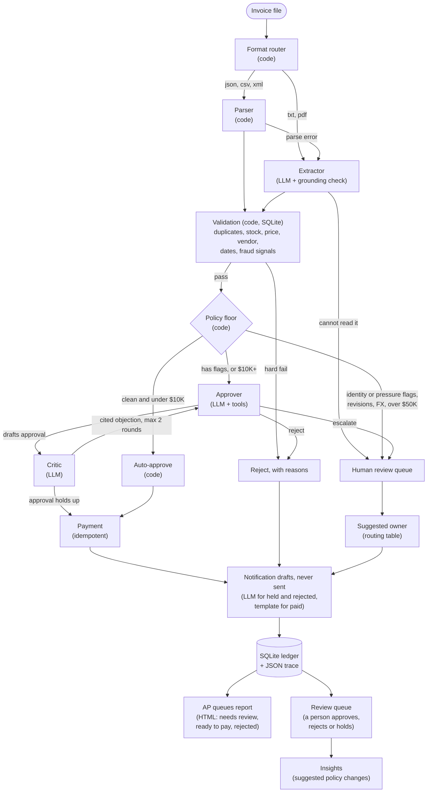

# Acme Corp invoice processing: a multi-agent AP system

Acme Corp is a PE-backed manufacturer losing about $2M a year to manual invoice processing: a 30% error rate, five-day delays, and approval by email chain. This repo is a working prototype that automates the whole path. It reads an invoice in any of five formats, checks it against inventory and vendor records, decides whether to pay, and either pays it, rejects it with reasons, or hands it to a person with the evidence.

The original case brief is in [docs/CASE.md](docs/CASE.md).

**The short version**

- **Most of the system is plain code, on purpose.** Arithmetic, stock lookups and duplicate checks are exact, so they run as code. An LLM is called only where there is ambiguity to reason about: reading messy text, weighing flagged invoices, and a second-opinion review.
- **A clean invoice costs zero model calls, start to finish.** It is approved, paid and notified by code. Across the 20 sample files the live run averaged 1.3 model calls per invoice, because the model also reads messy text and writes the notes for held and rejected invoices.
- **The model can only make a decision more cautious.** A deterministic policy floor runs first and the model can never override it.
- **It was evaluated, not just demoed.** 70 live runs of the judgment cases produced 0 unsafe approvals (details below), and 235 tests pass.

## Quick start

Developed and tested on Python 3.13 (3.10+ should work; only 3.13 was tested).

```bash
git clone https://github.com/tiffpvrl/galatiq-case-invoices.git && cd galatiq-case-invoices
python3 -m venv .venv && source .venv/bin/activate
pip install -r requirements.txt

python main.py --invoice_path=data/invoices/invoice_1001.txt   # one invoice, full detail
python main.py --all --fresh --open                             # all samples, then open the HTML report
python main.py --review                                         # resolve escalated invoices
python main.py --insights                                       # policy suggestions from review decisions
pytest                                                          # 235 tests, about 12 seconds
```

With no API key, everything runs on an **offline mock provider** (rule-based extraction, canned reasoning), so these commands work immediately. For real model reasoning, copy `.env.example` to `.env` and set one of:

| Provider | Setting |
|---|---|
| Grok (the case's specified engine) | `XAI_API_KEY=...` |
| Any OpenAI-compatible endpoint | `LLM_BASE_URL=...`, `LLM_API_KEY=...`, `LLM_MODEL=...` |

I tested the system using Claude, since that was the API available to me. It's built for Grok's API as the case specifies (set `XAI_API_KEY`), and runs on any OpenAI-compatible endpoint (see `.env.example`).

Other useful flags: `--json` (machine-readable), `--brief` (one line per invoice), `--offline` (force the mock), `--provider grok|custom|mock`, `--reserve-stock`, `--as-of YYYY-MM-DD`, `-v` (structured trace to stderr), `--open` (open the HTML report), `--no-report`. Each run writes `runs/<run-id>/report.html`, a JSON-lines trace, and the notification drafts (nothing is ever sent).

The SQLite inventory is created and seeded automatically on first run. The four starter rows from the brief are unchanged; three extra SKUs let a clean invoice over $10K exist for testing.

## How it works



Every invoice ends in exactly one of three outcomes: **Paid**, **Rejected** (with reasons), or **Needs human review** (with reasons).

### Agent or plain code?

| Step | Type | Why |
|---|---|---|
| Format routing, json/csv/xml parsing | Code | Structured input: a parser is exact, free and testable |
| Extraction from txt and PDF | **LLM agent** | Typos, free-form layouts and OCR errors defeat regex |
| Grounding check (is every extracted value in the source?) | Code | Normalized string matching beats a model judging a model. Its errors drive the retry |
| Duplicate, revision and rebill checks | Code | Lookups on the ledger |
| Inventory, price, vendor, date and fraud checks | Code | SQL and arithmetic with explicit rules |
| Policy floor | Code | Deterministic. The model cannot override it |
| Approver | **LLM agent** | Weighs mixed evidence, verifies claims with five read-only tools |
| Critic | **LLM agent** | An independent second reviewer who must cite a real finding to object (maker/checker) |
| Payment, rejection | Code | Side effects must be deterministic |
| Notification drafts | **LLM agent** for held and rejected; template for paid | Phrases facts it is given for the person who must act; a paid invoice has nothing to explain, so it costs no model call |
| Suggested owner, vendor correction request, HTML report | Code | A routing table, a template, and a static report: nothing here needs a model |

### Agentic capabilities the brief asks for

- **Function calling.** The approver verifies claims with `get_item_stock`, `get_catalog_price`, `get_vendor`, `get_invoice_history` and `get_vendor_history`.
- **Structured outputs.** Every agent must return an object that validates against a Pydantic schema via a final `submit` call; invalid submissions are sent back for correction.
- **Self-correction loops.** Extraction is checked against the source and re-prompted with the specific errors, up to 3 times. The approver and critic loop is capped at 2 rounds in code.

### Safety properties (each is tested)

- A hard-failed invoice never reaches the approver, and never reaches payment.
- The model can only move a decision toward caution. Final decision = most cautious of the policy floor and the model.
- Any error, whether an LLM outage, a payment failure or an unexpected exception, ends in human review, never in a payment.
- The approver sees structured fields only, never the raw document. Invoice free text is passed as labeled untrusted data, and known injection phrasing is caught in code before any model runs.
- Payment is idempotent. Re-running a file cannot pay twice.
- "Unreadable" is never treated as "invalid". A garbled or truncated file goes to a person, not to rejection.

## How this fits Acme's process

In practice this runs in the background and the AP team works from queues, not from a command line.

| Who | What they use it for |
|---|---|
| **AP clerks** | Work the *needs review* queue. The job shifts from keying data to resolving exceptions |
| **AP manager / controller** | Watch volume, how much escalates, and the money held. Tune the rules using the insights report |
| **VP / CFO** | See only what crosses their approval tier ($10K, and $50K for the CFO) |
| **Treasury** | Handle foreign-currency invoices and release payments |
| **Buyers and vendor management** | Settle price disputes and vendor-master questions routed to them |
| **Auditors** | Read the trace and ledger: who decided what, and why |

**The intended flow.** Invoices arrive in a shared AP inbox, a supplier portal or an EDI feed. A watcher runs each one through the pipeline as it lands. Every invoice ends in one of three queues:

- **Ready to pay** feeds the next payment run. (Real AP releases payments in scheduled batches, often by a separate person. The prototype pays immediately with a mock call.)
- **Needs review** is a work queue, and each item names the role best placed to resolve it: Treasury for FX, the buyer for a price dispute, the controller for a suspected re-bill, the CFO above $50K.
- **Rejected** is blocked with its reasons. When every reason is one the vendor can fix, a correction request is drafted for an AP clerk to review. Possible fraud is never auto-contacted.

**Notifications.** A pop-up per invoice would bury people, so the design is a queue with counts as the main surface, an alert only for items needing action now, and a digest for the manager. The system writes the message content (to the suggested owner) as drafts. It never sends anything.

**What exists here and what production adds.**

| This prototype | Production would add |
|---|---|
| A CLI plus a static HTML report of the three queues, with suggested owners | A live workbench with sign-in, roles and an assignment workflow |
| Files read from a folder | Inbox, supplier portal and EDI intake, watching continuously |
| Mock payment, immediate | Scheduled payment runs and a release step by a second person |
| Notification and vendor drafts saved as files | Delivery by email or chat, an SLA clock on each queue, and a daily digest |
| An inventory table standing in for POs and receipts | Real PO and goods-receipt matching, and ERP posting |

## Domain reasoning

The rules come from how accounts payable works, not from guesses. The full write-up, with sources and where the evidence is thin, is in [docs/process-notes.md](docs/process-notes.md). The decisions that matter most:

- **Inventory stands in for the PO and goods receipt.** In a real P2P cycle, AP matches the invoice against the purchase order and the goods receipt (a "3-way match"). The brief provides only an inventory table, so we treat it as "goods ordered and received", and billing more than is on hand is billing beyond what arrived. This is our interpretation, and the README states it as one.
- **Hard fail vs. flag.** Hard-fail only when an invoice cannot be legitimate under any reading (negative values, missing vendor, an item that doesn't exist, billing beyond received goods, an exact duplicate). Everything caused by *our* uncertainty becomes a flag or goes to a human. A false approve loses money; a false reject costs a vendor dispute.
- **Thresholds are policy parameters, not facts.** There is no authoritative benchmark for approval limits; the sources are vendor guidance with examples between $500 and $5,000. The $10K scrutiny limit is the brief's own example. Everything lives in [invoice_ap/config.py](invoice_ap/config.py).
- **Price tolerance is asymmetric** (flag over 2% above list, but only over 10% below), because overpaying is the loss.
- **Stock is summed across lines.** INV-1013 bills WidgetA on three lines (15 + 5 + 2 = 22) against 15 on hand. Each line fits; the invoice doesn't.

## Results

### The 20 provided invoices

Identical outcomes on a live LLM run and on the offline mock:

| Outcome | Count | Invoices |
|---|---|---|
| **Paid** | 5, $19,140 | 1001, 1004, 1006, 1011 (pdf), 1015 |
| **Needs review** | 4, $27,225 | 1004 revised, 1010, 1012 (pdf), 1014 |
| **Rejected** | 11 | 1002, 1003, 1005, 1007, 1008, 1009, 1013 (json), 1016, plus the repeat copies of 1011, 1012 and 1013 |

The brief's own scenarios all behave as specified (stock mismatch, the zero-stock item, unknown items, the negative quantity). Roughly $181K of billed amounts across the 8 genuinely bad invoices was stopped; the remaining rejections are duplicates of invoices that were paid or reviewed.

Several traps were found in the data that the brief doesn't list:

- **INV-1013's total is wrong by $50** (lines $21,040 + 7% tax = $22,512.80, but it states $22,562.80).
- **INV-1007's total is wrong by $110** ($14,750 + $885 tax = $15,635, but it states $15,525).
- **INV-1008 ($9,900) and INV-1012 ($9,975)** sit just under the $10K scrutiny line.
- **INV-1012** bills under a new company name ("formerly FastShip Ltd.") and has OCR-style typos (`26-Jan-2O26`, `$3,500.O0`).
- **INV-1004** has a revision that, if approved in full, would double-pay: the system pays only the $4,050 difference.

### Model evaluation

A harness ([scripts/eval_judgment.py](scripts/eval_judgment.py)) reruns the 14 cases that reach the approver and scores the model against labeled ideal decisions. Full table: [docs/eval-results.md](docs/eval-results.md).

| Metric (14 cases x 5 live runs) | Result |
|---|---|
| Decisions in the ideal set | 100% of 70 runs |
| Unsafe approvals (approved where holding was ideal) | 0 |
| Over-caution | 0 |
| Run-to-run self-agreement | 99% |
| Paraphrased prompt injection that bypasses the code defense | held in 5 of 5 runs |
| Real split billing across two invoices | escalated in 5 of 5 runs |

The first evaluation scored 95% with an inconsistent case. Reading the critic's objections showed two real design gaps: the approver had no way to look up a vendor's other invoices, yet claimed split billing was unlikely, and the critic couldn't see the approver's lookups. Both were fixed (a `get_vendor_history` tool; the critic now sees the actual lookup results), and the final numbers above are from after those fixes.

### Business impact

- **Speed.** The live run took about 4 seconds per invoice, against a baseline of days.
- **Control.** 80% of sample invoices were resolved without a person. The rest went to review with the reasons and evidence attached.
- **Token cost.** The 20-sample live run used about 36K input and 18K output tokens (1.3 model calls per invoice). Set `AP_PRICE_IN_PER_MTOK` and `AP_PRICE_OUT_PER_MTOK` in `.env` and the run summary shows dollars per invoice. The industry average cost to process an invoice manually is roughly $9–10; sources are vendor blogs, so treat that as directional.
- **Caution on extrapolation.** The sample set is deliberately adversarial (about half the invoices are bad), so these numbers show that the controls work, not what Acme would save. A savings estimate needs Acme's real invoice mix.

## Testing

235 tests, about 12 seconds, no network:

- **Golden outcomes** for all 20 sample files and 31 extra cases ([data/test_cases/](data/test_cases/), generated by [scripts/generate_test_cases.py](scripts/generate_test_cases.py), each with a documented purpose): boundaries at exactly $10,000 and exactly the stock on hand, duplicates across file formats, near-miss item names, malformed and garbage files, prompt injection, re-billing under a new invoice number, and more.
- **Agent mechanics** with scripted providers: loop bounds, citation rules, extraction retry, tool-use loops.
- **Wire-level tests** for Grok: a local HTTP server using xAI's documented response shapes, driven by the real `openai` SDK.
- **Safety invariants**: never pay on error, never pay a hard fail, idempotent payment.

## The report and the review queue

Every run writes a self-contained HTML report (`runs/<run-id>/report.html`, no network, works offline, light and dark themes, readable on a phone). It leads with a one-line summary for a manager, then the three queues: who each held invoice should go to, and for any invoice, the decision path, the reasons, the approver's reasoning and lookups, and the notification drafts. Everything that came from an invoice is escaped, because invoice text is untrusted.

The report is a snapshot, and review stays in the terminal on purpose: a local web page that can approve payments is a security surface that does not belong in a prototype.

`python main.py --review` is an interactive queue for escalated invoices: approve, reject or hold, with the reasons, the evidence and the suggested owner shown. Every decision is stored with a reviewer and note. Approving a revision pays only the difference.

`python main.py --insights` turns those decisions into *suggested* policy changes, such as "reviewers approved every single-flag FX invoice, so consider letting the approver weigh it". It uses only single-flag invoices (otherwise a decision can't be attributed to a flag) and requires a statistical bar, so "5 of 5" doesn't move policy but "12 of 12" does. Suggestions are never applied automatically. There are no real reviewer decisions yet; `scripts/simulate_reviews.py` creates a separate demo database, and the insights output labels simulated data clearly.

## Limitations and next steps

- **No real PO or goods-receipt tables.** The inventory table is a stand-in (see above). A production version would do a true 3-way match.
- **Paying doesn't decrement stock**, so two invoices can each pass against the same received goods. `--reserve-stock` exposes this using the ledger; a production system would keep a ledger of matched quantities.
- **Split billing is partly covered.** The approver can check a vendor's recent invoices, but there is no deterministic cross-invoice rule, and the sample data never exercises it beyond one constructed case.
- **No FX.** Non-USD invoices are escalated, not converted.
- **The rule-based text extractor was tuned on the ten sample text and PDF files.** On live runs the LLM matched it on every core field, but unseen layouts are the LLM's job, and that wasn't tested on a larger variety.
- **Evaluation is small and the labels are mine.** 14 cases, one provider, and ambiguous cases accept several decisions. It shows the approach works and gives a repeatable method, not a proof.
- **The critic never objected in the final evaluation.** It was valuable for finding the two gaps above; whether it earns its roughly 25% share of approval calls ongoing is open. A config lever exists to restrict it to high-stakes invoices.
- **A model can reject outright.** The LLM sometimes rejects an overcharged invoice instead of escalating it. Both are safe, but a stricter policy would let only humans reject.
- **Review is synchronous and in the terminal,** and the report is a static snapshot, not a live app. The next steps are asynchronous review with assignments, delivery of the drafts, and learning thresholds from real reviewer decisions.

## Repository layout

```
main.py                  CLI: process, --review, --insights
invoice_ap/
  pipeline.py            end-to-end flow for one invoice
  readers.py             json/csv/xml/txt/pdf readers (deterministic)
  text_extractor.py      rule-based extractor (offline mode, fallback)
  extract.py             LLM extraction + grounding retry loop
  grounding.py           is every extracted value in the source?
  validate.py            duplicates, stock, price, vendor, dates, fraud signals
  policy.py              the policy floor the model cannot override
  approval.py            approver + critic reflection loop, tools
  llm.py / mock_llm.py   LLM providers and the offline mock
  payment.py, ledger.py, db.py, tools.py, trace.py
  routing.py, notify.py  suggested owner, notification and vendor drafts
  html_report.py         the AP queues report
  review.py, insights.py human review queue, policy suggestions
  evals.py               model evaluation harness
  config.py              every threshold, with rationale
scripts/                 check_llm, eval_judgment, generate_test_cases, simulate_reviews
data/invoices/           the 20 provided invoices
data/test_cases/         31 extra cases + expected outcomes
tests/                   235 tests
docs/                    CASE.md (the brief), architecture, process-notes, eval-results
```

More detail: [docs/architecture.md](docs/architecture.md) (design and failure paths), [docs/process-notes.md](docs/process-notes.md) (the AP domain research and its sources), [docs/eval-results.md](docs/eval-results.md) (the evaluation).
