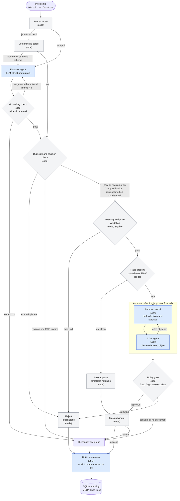

# Architecture

Rules and thresholds referenced here are justified in [process-notes.md](process-notes.md).

## Flow

Blue nodes are LLM agents. Grey nodes are plain code. Every node writes to the audit log.

## Why each step is an agent or plain code

An LLM is used only where the step needs to interpret ambiguity or reason in language.

| Step | Type | Why |
|---|---|---|
| Format router, deterministic parser | Code | json, csv and xml are structured; a parser is exact, free and testable. Sending them to an LLM adds cost and hallucination risk |
| Extractor | **LLM agent** | Typos ("Vndr", "INVOCE"), free-form layouts, relative dates ("yesterday") and OCR-style errors defeat regex. Also the fallback when a parser fails |
| Grounding check | Code | Normalized substring match against the source is deterministic. An LLM judging an LLM is weaker than a string comparison. Its error messages drive the retry |
| Duplicate and revision check | Code | Lookup on invoice number, vendor and a hash of normalized fields |
| Inventory and price validation | Code | SQL lookups and comparisons with explicit hard-fail and flag rules |
| Auto-approve of clean invoices | Code | Nothing to weigh: no flags and not over $10K. An LLM here adds cost and non-determinism without adding information |
| Approver | **LLM agent** | Weighs mixed evidence (flags, amount, vendor, fraud language) and writes a rationale. Runs only when there is something to weigh |
| Critic | **LLM agent** | Adversarial second pass catches missed flags and inconsistent reasoning. This is the reflection loop the case requires |
| Policy gate | Code | Deterministic override after the loop: certain flags force escalation whatever the LLM said |
| Payment, reject | Code | Side effects must be deterministic and only run on an explicit approval |
| Notification writer | **LLM agent** | Turns structured reasons into a clear human-readable message. Lowest risk, so it is the first thing to cut if time is short |

Safety properties:
- A hard-failed invoice never reaches the approver.
- The LLM cannot approve past a fraud-type flag, because the policy gate runs after the loop.
- The retry loop only fires when a value is ungrounded or present-but-missed. A field that is genuinely absent from the source (e.g. INV-1009's null vendor) is not retried, because the LLM would invent it. It goes straight to validation and hard-fails.

## Parsing and grounding details

- **Parser failure:** a malformed file or a schema the parser does not recognise falls back to the Extractor, with the parse error as a hint. Capped at 3 tries, then human review.
- **Grounding differs by path:** the LLM path gets the full check that every extracted value appears in the source. The parser path skips it (values come straight from the source) and relies on the validation stage's totals and required-field checks.
- **Normalization before comparing:** case, whitespace, punctuation, thousands separators, and OCR confusables (letter O vs digit 0, l vs 1). `26-Jan-2O26` and `$3,500.O0` in INV-1012 must not cause a false mismatch.
- **Item names:** normalize case and whitespace only ("Widget A" = "WidgetA"). **No fuzzy matching**: "WidgetC" is one edit from "WidgetA", so fuzzy matching would turn an unknown item into a pass. Still-ambiguous names escalate rather than reject.
- **Relative dates** ("yesterday") resolve against the invoice date. Past-due checks use a configurable as-of date, not the wall clock, because all sample invoices are dated January 2026.

## Duplicate and revision handling

| Case | Handling |
|---|---|
| Same invoice number, vendor and content hash (hash over normalized fields, so the same invoice in two file formats collides) | Exact duplicate. Reject |
| Same number and vendor, different content, original **not paid** | Mark the original `superseded`, link the two, process the revision as a fresh invoice |
| Same number and vendor, different content, original **paid** | Never auto-pay. Human review with the delta (INV-1004: $5,940 vs. $1,890 paid = $4,050) |
| Same number, **different vendor** | Flag: ID collision or fraud |
| Revision with no original on file | Flag |

Revisions are detected by comparing number, vendor and hash, not by trusting a `revision` field.

## Extraction schema

Must-have (a missing field triggers a retry only if it exists in the source, otherwise a validation hard fail): `invoice_number`, `vendor`, `date`, `due_date`, `line_items[{item, quantity, unit_price}]`, `total`.

Optional: `currency`, `payment_terms`, `tax`, `shipping`, `notes`.

Anything else lands in `extras` (a JSON object). It is stored in a JSON column in SQLite, so no separate flexible database is needed. Extra fields never block processing, but urgency-style notes feed the fraud flags.

## SQLite tables

| Table | Columns | Purpose |
|---|---|---|
| `inventory` | `item` PK, `stock`, `unit_price` | Goods received and on hand, plus catalog price. Stands in for the PO and goods receipt. Seed keeps the README's four rows unchanged and adds more SKUs |
| `vendors` | `name` PK, `approved` | Unknown-vendor flag |
| `invoices_processed` | `invoice_number`, `vendor`, `content_hash`, `total`, `status`, `supersedes`, `reasons` JSON, `extras` JSON, `created_at` | Duplicate and revision checks, audit trail, and the data behind the UI |

Known limitation: paying an invoice does not decrement stock, so two invoices can each pass against the same received goods. Production fix: a ledger of matched quantities. Not done here because it would make results depend on processing order.

## Approval loop safeguards

- Hard cap of 2 rounds, enforced in code. The worst case is escalation, never a stuck run.
- The critic returns a typed verdict. An objection must cite a specific flag or fact from the evidence; uncited objections are ignored.
- If the approver reverses a prior decision, stop and escalate.
- Temperature 0. Tests use a mock LLM for determinism.
- Escalation rate is reported in the evals, so a critic that objects to everything shows up as a number.

## Failure paths

| Failure | Handling |
|---|---|
| Parser error | Fall back to the extractor |
| Grounding check fails | Re-prompt the extractor with the specific errors, up to 3 tries, then human review |
| LLM call errors or times out | Retry with backoff, then human review. Never pay on an error |
| Validation hard fail | Reject, log reasons (each marked disputable or not), notify |
| Critic and approver still disagree after 2 rounds | Human review |
| Payment returns a failure | Human review, logged |

## Decision outcomes

Every invoice ends in exactly one of: **Paid**, **Rejected** (with reasons), or **Needs human review** (with reasons).

## Tunable assumptions (config, not code)

Extra-scrutiny limit $10,000; auto-approve eligibility (clean and no flags); near-threshold band 5%; price tolerance 2% with dollar cap; extraction retry cap 3; critique rounds 2; as-of date for past-due checks.
