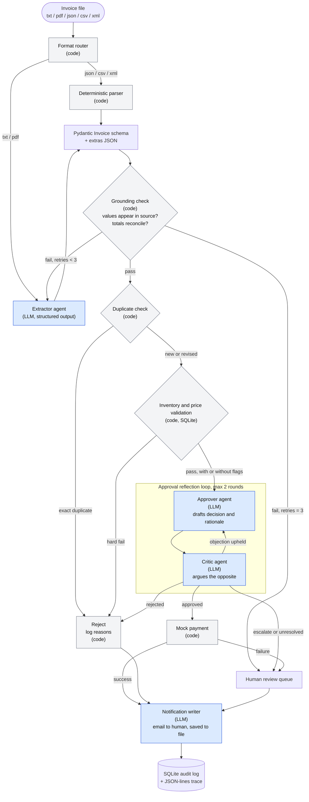

# Architecture

Rules and thresholds referenced here are justified in [process-notes.md](process-notes.md).

## Flow

Blue nodes are LLM agents. Grey nodes are plain code. Every node writes to the audit log.

## Why each step is an agent or plain code

An LLM is used only where the step needs to interpret ambiguity or reason in language.

| Step | Type | Why |
|---|---|---|
| Format router, deterministic parser | Code | json, csv and xml are structured; a parser is exact, free and testable. Sending them to an LLM adds cost and hallucination risk |
| Extractor | **LLM agent** | Typos ("Vndr", "INVOCE"), free-form layouts and relative dates ("yesterday") defeat regex |
| Grounding check | Code | Substring match against the source and arithmetic are deterministic. An LLM judging an LLM is weaker than a string comparison. Its error messages drive the retry |
| Duplicate check | Code | Lookup on invoice number, vendor and content hash |
| Inventory and price validation | Code | SQL lookups and comparisons with explicit hard-fail and flag rules |
| Approver | **LLM agent** | Weighs a mix of evidence (amount, flags, fraud language, vendor) and writes a rationale |
| Critic | **LLM agent** | Adversarial second pass catches missed flags and inconsistent reasoning. This is the reflection loop the case requires |
| Payment, reject | Code | Side effects must be deterministic and only run on an explicit approval |
| Notification writer | **LLM agent** | Turns structured reasons into a clear human-readable message. Lowest risk, so it is the first thing to cut if time is short |

Safety property: the LLM can only move an invoice toward escalation or rejection beyond what the code rules allow. It can never approve an invoice that validation hard-failed, because that path never reaches the approver.

## Extraction schema

Must-have (a missing field triggers a retry, then escalation): `invoice_number`, `vendor`, `date`, `due_date`, `line_items[{item, quantity, unit_price}]`, `total`.

Optional: `currency`, `payment_terms`, `tax`, `notes`.

Anything else lands in `extras` (a JSON object). It is stored in a JSON column in SQLite, so no separate flexible database is needed. Extra fields never block processing, but urgency-style notes feed the fraud flags.

## SQLite tables

| Table | Columns | Purpose |
|---|---|---|
| `inventory` | `item` PK, `stock`, `unit_price` | Stock and catalog price (seed extends the README's starter schema) |
| `vendors` | `name` PK, `approved` | Unknown-vendor flag |
| `invoices_processed` | `invoice_number`, `vendor`, `content_hash`, `total`, `status`, `reasons` JSON, `extras` JSON, `created_at` | Duplicate check, audit trail, and the data behind the UI |

## Failure paths

| Failure | Handling |
|---|---|
| Grounding check fails | Re-prompt the extractor with the specific errors, up to 3 tries, then human review |
| LLM call errors or times out | Retry with backoff, then human review. Never pay on an error |
| Validation hard fail | Reject, log reasons, notify |
| Critic and approver still disagree after 2 rounds | Human review |
| Payment returns a failure | Human review, logged |

## Decision outcomes

Every invoice ends in exactly one of: **Paid**, **Rejected** (with reasons), or **Needs human review** (with reasons).

## Tunable assumptions (config, not code)

Auto-approve limit $1,000; extra-scrutiny limit $10,000; near-threshold band 5%; price tolerance 2% with dollar cap; extraction retry cap 3; critique rounds 2.
